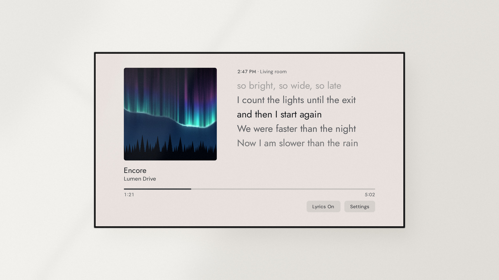
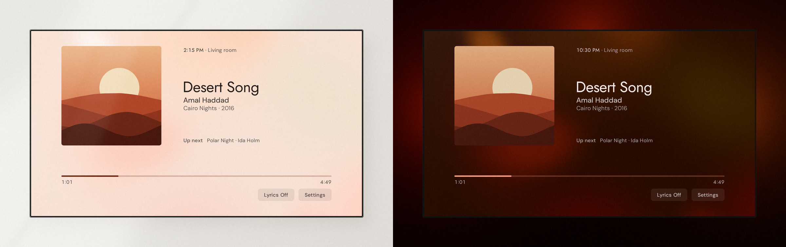

<div align="center">

<picture>
  <source media="(prefers-color-scheme: dark)" srcset="docs/screenshots/logo-wide-dark.png">
  
</picture>

### What's playing, on your TV, with the lyrics big enough to sing along.

[![Android TV][tv-badge]](#devices)
[![Home Assistant][ha-badge]][ha-url]
[![Music Assistant][ma-badge]][ma-url]
[![License][license-badge]](LICENSE)

Works with any media player in Home Assistant, and with Music Assistant for the lyrics.

<a href="https://github.com/vednolacni/encore/releases/latest/download/encore.apk"><picture><source media="(prefers-color-scheme: dark)" srcset="docs/screenshots/download.png"></picture></a>

[Install](#install) &middot; [Devices](#devices) &middot; [Remote](#remote) &middot; [Sendspin](#sendspin) &middot; [Privacy](#privacy)

<picture>
  <source media="(prefers-color-scheme: dark)" srcset="docs/screenshots/mockup-now-playing.jpg">
  
</picture>

</div>

---

Put on a song and the TV shows it. The album cover sits on the left with the title under it, the
lyrics run beside it line by line as they're sung, and a progress bar crosses the screen with two
buttons under it, one for the lyrics and one for the settings.

Encore started as a fork of [Klangbild](https://github.com/hazymorning/Klangbild), a calm now
playing screen for the TV. I kept its care for the picture and turned it into a player, with the
lyrics large on screen and the controls in reach.

There's nothing to install in Home Assistant and nothing to type on the remote. The APK goes on
the TV, and a QR code sets it up from your phone.

## Features

- 🎤 Lyrics large beside the cover, line by line as they're sung
- 🎨 The cover's own colors as the background, drifting slowly while the music plays
- 🌗 A light background by day and a dark one at night, following the sun
- 💡 The lights behind the TV in the cover's colors, given back as they were when the music ends
- 🔊 The TV as a speaker of its own, in time with the others, through [Sendspin](#sendspin)
- 📚 Chapters, playback speed and quick jumps for audiobooks and podcasts
- 🧩 Buttons of your own in the quick settings, for any script, scene or automation
- 🌡️ Values from Home Assistant next to the clock, like the temperature outside
- 🎉 A QR code for the guests of a Music Assistant party, right where the cover stands
- 🌙 A sleep timer that can wait for the end of the chapter
- 📱 Setup on your phone through a QR code, with Home Assistant's own sign-in

## Requirements

| Requirement | Why |
|---|---|
| A TV or box with Android TV 9 or later | The oldest version Encore runs on (see [Devices](#devices)) |
| Home Assistant | Tells Encore what's playing and carries the remote's commands to the speaker |
| A media player in Home Assistant | The speaker whose music the TV shows |
| A phone | The setup page opens there from a QR code |
| Music Assistant (optional) | The lyrics, what's up next, the album's year and the chapters of audiobooks |
| Music Assistant 2.10.7 or later (optional) | Sendspin, so the TV can play along |
| The Android Debug Bridge integration (optional) | Lets Home Assistant open Encore when the music starts |

## Install

1. Install the APK on your TV. Encore isn't on Google Play, so open the
   [latest release](https://github.com/vednolacni/encore/releases/latest) in the free Downloader
   app, select `encore.apk` and allow installs from unknown sources when Android asks.
2. Open Encore and scan the QR code it shows with your phone, then sign in to Home Assistant.
3. Choose the speaker your music plays on and save. Music Assistant, the lights behind the TV and
   buttons of your own are on the same page, and all of them can wait.

> [!IMPORTANT]
> If Music Assistant plays your music, your speaker most likely shows up twice in the list, once
> from its own integration and once from Music Assistant. Choose the one marked Music Assistant,
> since only that one brings the lyrics and everything else Music Assistant knows about the song.

If the TV is connected to Home Assistant through the
[Android Debug Bridge integration](https://www.home-assistant.io/integrations/androidtv/), an
automation like this one opens Encore whenever your speaker starts playing. The two entity IDs are
only examples, so put in the ones for your own speaker and TV.

```yaml
triggers:
  - trigger: state
    entity_id: media_player.living_room
    to: playing
actions:
  - action: media_player.select_source
    target:
      entity_id: media_player.tv
    data:
      source: io.github.vednolacni.encore
```

## Day and night

During the day the background is light, and after sunset it turns dark, so the screen fits the
room at every hour. In the settings you can also keep one of them for good.



## Devices

Encore runs on TVs and boxes with Android TV 9 or later. Since the TV can stay on for hours, the
whole picture drifts slowly by a few pixels, which helps keep an OLED screen from burning in.

Fire OS is built on Android, and the Android version underneath most likely decides whether
Encore installs on a streaming stick that runs it. Fire OS 7 and later are built on Android 9 or
newer, which should be enough. Vega OS isn't Android at all, so Android apps most likely won't
install there.

## Remote

| Button | Action |
| --- | --- |
| OK | Play or pause (hold to open the settings) |
| Left / Right | Previous or next song |
| Down | Choose the buttons under the bar, and press again for the quick settings |
| Up / Back | Leave the buttons or the quick settings |

In the settings you can change what some of the buttons do, for example to have up and down
change the volume.

## Sendspin

With Music Assistant 2.10.7 or later, the TV can become one of its speakers and play in time with
the others over Sendspin. Once "Play here" is on, under System in the settings or with the box on
the setup page, it shows up in Music Assistant under its own name and keeps playing even while
Encore is closed.

## Privacy

Encore has no accounts and doesn't track you. Your logins for Home Assistant and Music Assistant
are stored encrypted on the TV and never go anywhere but your own servers.

## Support

- [Ideas and questions](https://github.com/vednolacni/encore/discussions), always welcome
- [Report a bug](https://github.com/vednolacni/encore/issues)
- [Music Assistant documentation](https://www.music-assistant.io)
- [Android Debug Bridge, Home Assistant documentation](https://www.home-assistant.io/integrations/androidtv/)

## Credits

The type, the light, the motion and the care for what's on screen come from
[Klangbild](https://github.com/hazymorning/Klangbild) by hazymorning, and Encore keeps
hazymorning's copyright beside its own. Thanks to hazymorning for the work it builds on.

Developed with the assistance of AI.

## License

MIT, like Klangbild before it (see [LICENSE](LICENSE)).

[tv-badge]: https://img.shields.io/badge/Android%20TV-9%2B-3DDC84.svg
[ha-badge]: https://img.shields.io/badge/Home%20Assistant-media%20player-41BDF5.svg
[ha-url]: https://www.home-assistant.io/integrations/media_player/
[ma-badge]: https://img.shields.io/badge/Music%20Assistant-optional-F2A47C.svg
[ma-url]: https://www.music-assistant.io
[license-badge]: https://img.shields.io/badge/License-MIT-green.svg
